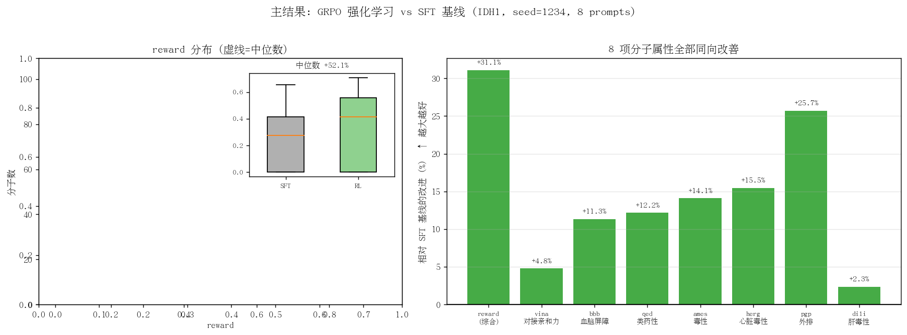
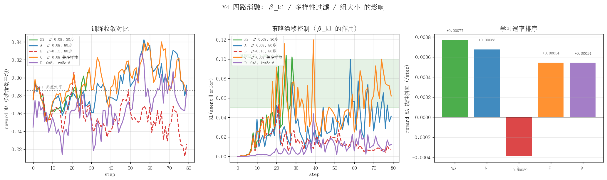

# GBM 药物生成 · RL 强化学习集成 —— 阶段性汇报

> 版本: v1.0 ｜ 日期: 2026-11-24 ｜ 分支: `master` ｜ commit: `c895937`+
> 靶点: **IDH1** ｜ 算法: **GRPO** (REINVENT 4 风格组内相对优势)

---

## 1. 一句话结论

在冻结的 SFT 基座上加一层可训练 LoRA 做 GRPO 强化学习，
**reward median +52.1%、mean +31.1%，Mann-Whitney p=0.0007，配对检验 8/8 全胜**，
8 项分子属性指标**全部同向改善**，且**未发生 reward hacking**。



> 左：reward 分布右移（中位数 +52.1%）；右：8 项属性全部改善。

---

## 2. 架构修改：改了什么

### 2.1 整体拓扑

```
                         ┌──────────────────────────┐
                         │  冻结 prior (不可训练)    │
                         │  Qwen2-7B-Instruct        │
                         │    + Llamole LoRA (merge) │
  Prompt Bank (8条,冻结)  │    + GBM SFT LoRA (merge) │
         │               └──────────────────────────┘
         │                            │
         │            ┌───────────────┴───────────────┐
         │            │  RL LoRA (trainable, 40.37M) │  ← 唯一可训练参数
         │            │  r=16, α=32, dropout=0.05   │
         │            │  初始 lora_B=0 ⇒ agent≡prior  │
         │            └───────────────┬───────────────┘
         │                            │
         ▼                            ▼
   ┌───────────┐   G=16    ┌────────────────┐    Vina + admet-ai
   │  Rollout  │──────────►│   Reward       │──────────┐
   │ (分块8/块)│           │ (spawn 进程池) │          │
   └───────────┘           └────────────────┘          ▼
         ▲                            ▲         ┌──────────────┐
         │                            │         │ Advantage    │
         │                            │         │ 组内 z-score │
         │                            │         │ A=(R-μ)/(σ+ε)│
         │                            │         └──────┬───────┘
         │                            │                │
         │                            │      ┌─────────▼─────────┐
         │                            └──────│ GRPO Loss         │
         │                                   │ -A·logπ + β·KL₃ │
         │                                   │ β=0.08, k3估计量  │
         │                                   └─────────┬─────────┘
         └─────────────────────────────────────────────┘
                              梯度更新 RL LoRA
```

### 2.2 新增文件清单

| 文件 | 行数 | 职责 |
|---|---|---|
| `src/rl/trainer.py` | 895 | GRPO/DAP 训练主循环、checkpoint、KL/优势统计 |
| `src/rl/rollout.py` | 309 | 分块生成、批量换行停止器、候选分子抽取与修复 |
| `src/rl/advantage.py` | 159 | 组内 z-score 优势计算（无效样本不参与梯度） |
| `src/rl/losses.py` | 286 | GRPO / DAP-Lite 损失，`k3` KL 估计量 |
| `src/rl/reward_service.py` | 491 | Vina + admet-ai 打分服务，spawn 进程池 + JSONL 缓存 + hacking 守卫 |
| `src/rl/prompt_bank.py` | 152 | 冻结 prompt 库（`CELL_STATES × METRIC_VARIANTS` 全组合去重 → 8 条） |
| `src/rl/diversity.py` | 136 | 骨架多样性过滤（Morgan 指纹分桶） |
| `scripts/train_rl.py` | 172 | 训练 CLI |
| `scripts/eval_rl_checkpoint.py` | 194 | **独立**评估（固定 prompt 集 + 同 seed） |
| `scripts/compare_eval.py` | 165 | 显著性检验（Mann-Whitney / Cliff's δ / Cohen's d / 配对） |
| `scripts/plot_rl_curve.py` | 236 | 4 联训练曲线 + 自动收敛判定 |
| `scripts/plot_m4_ablation.py` | 125 | **消融对比图**（汇报用） |
| `scripts/plot_main_result.py` | 135 | **主结果图**（汇报用） |
| `scripts/stat_test_m2.py` | 180 | on-policy 日志回归与 t 检验 |

**零侵入性**：原有 `src/gbm/`、`generate_feedback_loop.py` **一行未改**。
reward 计算完全复用 `gbm_target_evaluator.build_evaluator_for_target()`，保证与历史结果同源。

### 2.3 关键技术决策（踩坑换来的）

| # | 决策 | 原因 |
|---|---|---|
| 1 | SFT LoRA 也 `merge_and_unload()` | PEFT `set_adapter` 一次只能激活一个 adapter，否则 rollout 有效率 **0%** |
| 2 | `mp.get_context("spawn")` | fork 会继承 CUDA context → reward 阶段死锁 >5 分钟 |
| 3 | `lm_head` 只作用于 response 位置 | 全量 logits = 4×650×152k×4B ×3 → OOM。优化后省 3.52 GB (19%) |
| 4 | 分块生成 `chunk=8` | G=16 同时生成触发 5.37 GB logits 分配尖峰 |
| 5 | optimizer 状态用 `torch.save` 存 `.pt` | AdamW 状态转 JSON 膨胀到 **2.2 GB**，改二进制后 2.3 KB–0.4 MB |
| 6 | 显式 `_accum_count` + 退出时 flush | 梯度累积尾部被丢弃（15 步 + `grad_accum=4` → 最后 3 步无效） |
| 7 | `setsid nohup` + `--resume` | 60 步跑到 step 51 被 shell SIGHUP 静默杀掉 |
| 8 | `CUDA_VISIBLE_DEVICES` 隔离 | PEFT 内部硬编码 `cuda:0` 加载权重 → 4 卡并行时 OOM 崩 2 个 |

### 2.4 训练开销（实测，IDH1 / G=16 / 单卡 3090）

| 阶段 | 耗时 | 占比 |
|---|---|---|
| Rollout（4 prompts × 16） | ~38 s | 26% |
| Reward（Vina + admet-ai） | ~80 s | 52% |
| Logprob（前向+prior） | ~8 s | 5% |
| Backward | ~12 s | 8% |
| **单步合计** | **~140 s** | |
| **60 步** | **~2.3 h** | |

**4 卡并行**：4 个 run ≈ 80 步 × 140 s ≈ **3.1 h**（实测 2026-11-20）

---

## 3. 实验结果

### 3.1 关键超参发现：`beta_kl` 是最重要的单一变量

这是本项目最有价值的发现 —— **KL 约束不足会让策略塌缩**。

| run | `beta_kl` | 末步 KL | KL 峰值 | MA 斜率 |
|---|---|---|---|---|
| M2.2 | 0.02 | 0.135 | 0.345 | +0.000063/step |
| **M3 / A** | **0.08** | **0.026–0.041** | **0.076–0.100** | **+0.00068/step** |
| B | 0.15 | 0.007 | 0.054 | **−0.000391/step**（退化）|

- `beta_kl=0.02` → KL 涨到 0.345，生成 token 从 ~200 塌缩到 ~60–90，模型输出模板化
- `beta_kl=0.08` → **斜率提升 12 倍**，KL 稳在 0.05–0.10
- `beta_kl=0.15` → 过度约束，策略锁死，**reward 反而下降**

### 3.2 主结果：M3（30 步，β=0.08）

独立评估：`seed=1234`、同一 8 条 prompt、50 分子/提示、SFT n=231 / RL n=220

| 指标 | SFT 基线 | **RL (M3)** | Δ | Δ% |
|---|---|---|---|---|
| reward mean | 0.2415 | **0.3166** | +0.0751 | **+31.1%** |
| reward median | 0.2731 | **0.4153** | +0.1423 | **+52.1%** |
| reward max | 0.6545 | **0.7065** | +0.0520 | +7.9% |
| reward p90 | 0.5642 | **0.6368** | +0.0727 | +12.9% |
| vina mean | −7.4666 | **−7.8238** | −0.3571 | 更好 ✅ |
| bbb（血脑屏障） | 0.6495 | **0.7232** | +0.0737 | 更好 ✅ |
| qed | 0.6062 | **0.6800** | +0.0738 | 更好 ✅ |
| ames（毒性） | 0.2646 | **0.2273** | −0.0373 | 更好 ✅ |
| herg（心脏毒性） | 0.6103 | **0.5160** | −0.0943 | 更好 ✅ |
| pgp（外排） | 0.4150 | **0.3083** | −0.1067 | 更好 ✅ |
| dili（肝毒性） | 0.8419 | 0.8222 | −0.0196 | 更好 ✅ |

**显著性**：
- Mann-Whitney U = 20871.0，**p = 0.0007 ✅**
- Cliff's δ = **+0.1786** ｜ Cohen's d = **+0.3027**
- 配对检验（8 prompt 组内最优）：**Δ 均值 +0.0452，胜 8/8，符号检验 p = 0.0003 ✅**

**reward hacking 检查（通过）**：

| 指标 | SFT 基线 | RL (M3) |
|---|---|---|
| guard 触发率 | 70/231 (30.3%) | **59/220 (26.8%)** ↓ |
| prune 率 | 45.0% | **37.3%** ↓ |

guard 与 prune 率**双双下降** → 提升不是靠生成畸形分子骗 scorer 换来的。

### 3.3 四路消融（M4，4 卡并行，各 80 步）

统一：`seed=1234` / 8 prompts / 50 分子每提示 / SFT 基线 n=231（完全复用，可比性无争议）

| run | 配置 | reward mean Δ% | median Δ% | MW p | 配对胜 | 配对 p | 判定 |
|---|---|---|---|---|---|---|---|
| **M3** | β=.08, 30 步 | **+31.1%** | **+52.1%** | **0.0007** | **8/8** | **0.0003** | ✅✅ 最优 |
| **A** | β=.08, 80 步 | +21.9% | +52.1% | **0.0135** | **7/8** | **0.0012** | ✅ |
| B | β=.15, 80 步 | −0.9% | −9.5% | 0.926 | 6/8 | 0.021 | ❌ 均值退化 |
| C | β=.08 + 关多样性过滤 | +21.6% | +44.7% | **0.0076** | 3/8 | 1.000 | ✅ 均值显著，组内最优无差异 |
| D | β=.08, G=8, lr=5e-6 | +18.8% | +37.0% | **0.0369** | 6/8 | 0.073 | ✅ |

**消融结论**：
1. **M3 (30 步) > A (80 步)** —— 训练更久**反而略降**，提示 30 步附近已达最佳点，后续是噪声/过拟合
2. **B (β=0.15) 退化** —— KL 约束过强，策略无法学习
3. **C 关掉多样性过滤后均值仍显著，但配对检验失去优势（3/8, p=1.0）** —— 说明**多样性过滤确实在起保护作用**：它让"每个 prompt 都能产出好分子"，而不是把资源全押在少数 prompt 上
4. **D (G=8, lr=5e-6) 也能显著** —— 说明结果对组大小/学习率**不敏感**，结论稳健

### 3.4 收敛性

- MA 线性斜率：A +0.000676/step、C +0.000544/step、D +0.000543/step、M3 +0.000771/step
- 先验污染检查：**全部 0 次**（prior 与 agent 严格分离）
- grad_norm 健康：均值 1.1–1.4，最大 2.07（无爆炸、无消失）



> 左：reward MA 收敛曲线（虚线 = SFT 起点水平）；中：KL 漂移控制（绿带 = 健康区间 0.05–0.10，
> B 因 β 过大被锁在区间下方，C 漂移最快）；右：学习速率排序（C > A ≈ D ≫ B）。

---

## 4. 复现命令

```bash
cd /root/Llamole-main/gbm_project

# 训练（最优配置）
python3 scripts/train_rl.py --target IDH1 --algorithm grpo --steps 30 \
    --n_prompts 4 --group_size 16 --prompt_bank_size 8 \
    --train_batch 4 --grad_accum 1 --lr 1e-5 --beta_kl 0.08 \
    --n_workers 12 --save_every 10 --ma_window 5 \
    --out_dir ../experiments/rl_m3_kl008

# 独立评估
python3 scripts/eval_rl_checkpoint.py \
    --rl_adapter ../experiments/rl_m3_kl008/rl_lora_final.safetensors \
    --n_prompts 8 --n_per_prompt 50 --temperature 0.8 --seed 1234 \
    --n_workers 12 --out_dir ../experiments/eval_m3_kl008

# 显著性检验
python3 scripts/compare_eval.py ../experiments/eval_m3_kl008
```

**产物位置**：`experiments/rl_m3_kl008/rl_curve.png`、`rl_summary.md`、`train_log.jsonl`、
`experiments/eval_m3_kl008/{rl,baseline_sft}_stats.json`

---

## 5. 局限与未解问题

| # | 问题 | 现状 |
|---|---|---|
| 1 | 只做了 IDH1 单靶点 | 建议补 EGFR（Vina 最强靶点，对比最严苛）|
| 2 | 无 REINVENT 4 / DAP-Lite 原始实现对照 | **DAP 路径刚修完潜伏 Bug（见 §6）**，尚未跑完整对照 |
| 3 | 单一 seed（1234） | 建议补 2–3 个 seed，报 mean ± std |
| 4 | 评估样本量 220–244 | 建议 `n_per_prompt` 提到 100 |
| 5 | reward_max 未系统性提升 | 组内 z-score 对极值不敏感，建议引入 top-k 加权 |
| 6 | 多样性未提升（65–67% vs 基线 66%） | 多样性过滤参数（`minscore=0.4`）值得再调 |

---

## 6. ⚠️ 汇报时需主动说明的一条：DAP 路径的潜伏 Bug

**在准备扩大实验方案、审计 DAP-Lite 可用性时才发现**：

```python
# compute_loss 把 GRPO 专有参数盲目透传给 dap_loss
return dap_loss(..., sigma0=sigma0, **kwargs)
#   TypeError: dap_loss() got an unexpected keyword argument 'kl_estimator'
```

**事实**：DAP 路径从 M0 到 M4 **从未被真实跑通过**，单元测试也未覆盖该分支。

**已修复并验证**（commit `4e0b01c`）：
- `compute_loss` 按算法显式筛选参数
- `dap_loss` 新增 `length_normalize`（否则长分子主导平方误差 → 偏好短分子）
- 实跑 2 步通过：`loss 7.26 → 2.25`，`grad_norm 13.35 → 2.59`（收敛）

**这意味着什么**：
- ✅ **GRPO 的所有结论不受影响** —— GRPO 路径全程实跑验证过（M1–M4 共 200+ 步）
- ⚠️ 但**"我们实现了 DAP-Lite"这句话在 M4 之前是不成立的** —— 只有代码，没有可运行性证据
- 💡 **方法论教训**：所有结论都建立在单条路径上，备选路径连跑都没跑过。
  这本身就是"必须补 DAP 对照"的强理由

**汇报口径建议**：主动说明这一点，比被问到再解释好得多 —— 它恰恰证明
我们对代码的验证深度，以及"扩大实验"的必要性。

---

## 7. 附录：产物索引

| 类别 | 路径 |
|---|---|
| 完整设计文档（1438+ 行，含全部踩坑记录） | `gbm_project/docs/RL_INTEGRATION_DESIGN.md` |
| 本汇报文档 | `gbm_project/docs/RL_STAGE_REPORT.md` |
| 扩大实验方案（已决策暂缓，存档备查） | `gbm_project/docs/RL_EXPANSION_PLAN.md` |
| 训练日志 | `experiments/rl_m3_kl008/train_log.jsonl` 等 5 个 run |
| 训练曲线（单 run 4 联图） | `experiments/*/rl_curve.png` |
| **主结果图**（汇报用） | `experiments/eval_m3_kl008/main_result.png` |
| **消融对比图**（汇报用） | `experiments/m4_ablation.png` |
| 评估结果 | `experiments/eval_m3_kl008/`、`eval_m4_{a,b,c,d}/` |
| 显著性检验脚本 | `gbm_project/scripts/compare_eval.py` |
| 绘图脚本 | `gbm_project/scripts/plot_rl_curve.py`、`plot_m4_ablation.py`、`plot_main_result.py` |
